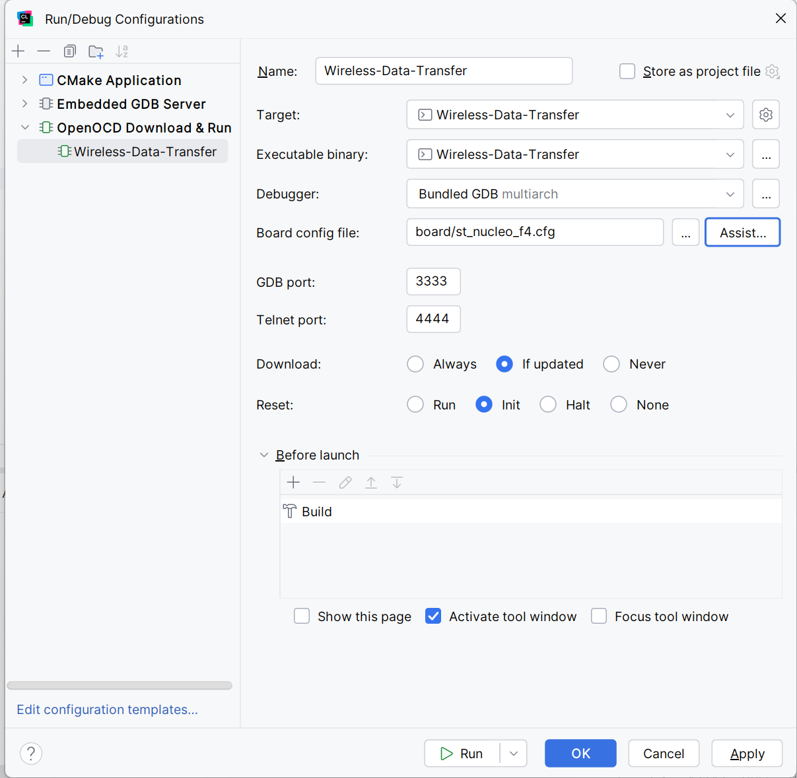

# Wireless Data Transfer

## Step 1. Setting up the project

I've created the project using cubeMX configured the pins and created code

## Step 2. ESP32 configuration

Unfortunately, I didn't have the suitable cable to connect the ESP32 to the computer. I had to use uart on stm32 
I've added ssd1306 display library for my oled 0.96 display. In order for them to work I had to add them to CMake so they are compiled with the other files

## Pin configuration